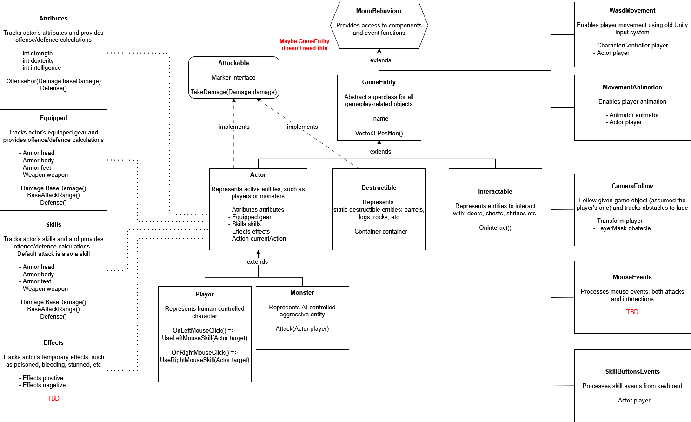

# adamant

ARPG Prototype.

## Movement

Currently, the player movement is controlled by `CharacterController` component, which provides collisions, gravity, and steps/slopes handling, so
`RigidBody` component is not used. Actual movement can be enabled by using:

1. Use root motion (RM) animation alone. This makes it easy to sync speed and animation, if movement is WASD-only, but will not work for
   click-to-move version of control (which is planned).
2. Use in-place animation with `CharacterController.Move()` call + set 'Apply Root Motion' flag in `Animator` compoment.

### WASD Movement

Requires two components: `CharacterController` for movement, and `Animator` for animation flow. Also, requires access to player's `Actor` object
for movement speed (buffs and debuffs).

### Click to Move Movement

By default, only applies when a player clicks on 'Interactable' object, e.g. monster or container.

### Monster Movement and Attacks

Monsters movement, is done via `Rigidbody.MovePosition()` and rotation, and the logic is put to `FixedUpdate()` method. Monsters require
path-finding to be able to walk around obstacles, so some reference to game world is required (at least within detection radius).

Monster attacks are based on detection radius, attack range, and path-building. Ideally, there is only one script providing both `MoveTo(Transform 
target)` and `Attack(Actor target)` methods to player and monsters.

## Player Interactions and Attacks

Each attack must include attacker's state, to avoid monsters get killed by just colliding with weapon model and vice-versa, and also the target
state to calculate hit or miss, and reduce it's health. Proposed combat flow is:

1. On each mouse click check if the target is `Interactable` (doors and chests) or `Attackable` (monsters and destructables). That defines the
   distance to the object:

    - for interactables is very close, e.g. 1 unit
    - for attacks it's weapon/skill range, e.g. 12 units

2. Based on the distance difference, move character closer. This requires `MoveTo(Transform target)` method call and both `Player` and `Animator`
   references. Player's game oject provides access to both `CharacterController` (movement), and `Actor.Equipped()`(weapon stats). To build a path,
   it's required to have an area representation, and path-building algorythm available. Automove can be interrupted by WASD, mouse click, or
   dash/roll.

3. Once the attacker (player or monster) reaches the destination, call `Attack(Actor target)` method independently. Each attack calculates hit chance
   and damage (with all buffs and debuffs), and calls `target.TakeDamage(Damage damage)`. This call returns `OnHit` object, which represents effects
   on attack (reflect/retaliate/counter-attack/life or mana leech etc). This damage or life/mana is applied to attacker and consider defences. For
   ranged attack/spells though, it spawns projectiles which call `Attack()` method on collision with `Attackable` object.

## Prototype Classes Hierarchy

Below there is a hierarchy of needed data classes, with almost no behaviour. A player has skills:

- default weapon attack on LMB
- AOE attack on RMB
- passive health regen as a coroutine (no indication)

A monster has only default attack, but may have equipped weapon and armor.

